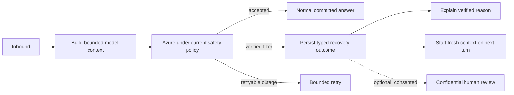

# Technical design and decision record

## PR #7 implementation decision (2026-10-08)

PR #7 already has `conversation_turn_effects`, deterministic outbound IDs, a transaction-scoped `ConversationUnitOfWorkPort`, and a dispatch ledger. The initial implementation uses those existing controls. It stores `conversationOutcome: input_filtered` and `sourceInboundMessageId` on the committed outbound message; no schema migration is needed for this slice. The application handles only a provider-confirmed **input** filter during initial classification, before model-derived effects begin. A later filter remains an error pending separate analysis of effects already performed. The worker logs the outcome without invented classification or risk values.

The history repository includes a recovery outcome by its source inbound time even when it was persisted after a later inbound. The shared model-context projection starts subsequent AI requests at that recovery outcome and excludes the rejected prompt, earlier turns, old active topic, memory, style, and goals. Durable history remains intact. The recovery wording reports only the verified Azure filter outcome and asks for a fresh standalone message. The full outcome enum, channel rendering contract, human review route, and same-policy retry remain future design work.

## Evidence and limits

- Read-only production checks on 2026-10-08 found six inbound turns without outbound responses. Railway worker jobs exhausted three attempts. Azure Monitor aggregate metrics at the matching minutes recorded `gpt-5.4-mini` `RAIRejectedRequests` classified `Sexual`, `Medium`, `USER_REQUEST`. Azure diagnostic settings were absent, so no per-request filter result or exact trigger is available.
- The first failed inbound was a workplace complaint with profanity and no apparent sexual topic. The filter result may be a false positive on the full prompt; the aggregate metric cannot prove which fragment triggered it. Do not copy participant text into this artifact or a test fixture.
- The active worker deployment was a Railway CLI upload with no Git commit hash. The source references below describe the current checkout, not a verified byte-for-byte production image.

## Current TypeScript path

1. `apps/worker/src/conversation/conversation.processor.ts` resumes a committed turn, checks eligibility and rapid-message coalescing, then calls the orchestrator. Its current catch masks the original error and throws `conversation_processing_failed`; production logs exposed more specific codes, confirming a source-provenance gap.
2. `packages/application/src/use-cases/conversation-orchestrator.ts` loads up to 20 scoped messages through the inbound anchor, builds turns, and calls `classifySituation` before risk assessment or reply planning. Some later effects, including risk signals, can be written before response generation; a catch around the whole use case cannot assume a clean rollback.
3. `packages/ai-openai/src/prompts/classify.ts` sends the last 15 turns in the transcript and repeats the latest employee text in a separate block. The first rejected inbound was still within this window for the latest affected turn.
4. `packages/ai-openai/src/openai-provider.ts` wraps each provider request in `CircuitBreaker`; `packages/ai-openai/src/circuit-breaker.ts` counts every exception, opening for 30 seconds after five failures within 60 seconds. A permanent input rejection is therefore treated as an availability failure.
5. The normal path commits a deterministic outbound ID and `conversation_turn_effects` record with dispatch intent, then queues delivery. `conversation_job_receipts` records completed jobs. These are the existing idempotency and recovery boundaries.

## Options

| Option | Benefit | Gap or risk | Decision |
| --- | --- | --- | --- |
| Remove the duplicate latest text in the classifier prompt | Reduces avoidable exposure and token use | A single copy may still trigger Azure; does not resolve silence, retries, or poisoned history | Include as a small independent improvement, not the incident fix |
| Typed failure plus persisted recovery outcome and context epoch | Supports an honest explanation, next action, later benign turns, audit, and Azure policy | Needs durable state, rendering, transaction and replay tests | Recommended foundation |
| Exclude only the latest rejected text from later prompts | Preserves more context | Azure does not identify the triggering fragment; an older turn or persisted summary could keep poisoning the prompt | Use a context boundary instead |
| Reduce and structure context before the first model request | Can prevent false positives and unnecessary repeated text, allowing a real answer under the same Azure policy | May lose intent or safety context; needs conversation-sim and live-language checks | Evaluate as a separate prompt-quality change |
| Retry the same inbound with less context through the same Azure deployment | May recover a substantive answer when only old history triggered the filter | Can hide context needed to interpret or safely answer an elliptical request; the triggering fragment is unknown | Defer automatic use pending explicit policy and self-containment criteria |
| Offer confidential human review | Can resolve disputed false positives and provide a genuine contextual response | Needs participant consent, authorized reviewer access, privacy audit, staffing, and latency expectations | Design as an optional recovery route |
| Retry with another model or paraphrase the rejected text | Might return a generated answer | Can bypass the safety decision and leak private text across providers | Exclude from automatic recovery |
| Lower Azure sexual-content threshold | Could reduce false positives | Changes the safety envelope for every user and does not fix error handling | Do not use for this incident |

## Recommended design

The application should own a typed `ConversationOutcome` such as `answered`, `input_filtered`, `output_filtered`, `temporary_provider_failure`, or `needs_review`. Each outcome carries verified reason codes and permitted next actions; the channel adapter renders the outcome. A response string is a presentation of the outcome, not the source of truth. Persist the chosen outcome and rendered outbound before delivery so a duplicate job resumes the same action. The first slice can render the fresh-context action as text; interactive Slack controls require a separate callback contract and are not a prerequisite.

Before adding a special retry path, reduce avoidable prompt duplication and test a bounded or summarized history against intent fidelity, safety, and language behavior. This is prevention: when the original request passes Azure, the agent can give a substantive answer. It does not authorize removing safety-relevant context after a rejection merely to force the request through.

### 1. Adapter error contract

Map provider errors into a bounded application-facing taxonomy: `input_filtered`, `output_filtered`, `invalid_request`, `rate_limited`, `transient`, and `unknown`. Keep original provider details inside the adapter. Log phase, HTTP status, normalized code, deployment, and Azure request ID when supplied, never request/response bodies. Unknown HTTP 400 is not assumed to be a content filter; treat it as a terminal technical failure for operator review rather than retrying the identical request or claiming the employee violated policy. Verify the actual Azure SDK error shape with an approved synthetic blocked request before relying on subtype parsing. Update `AiProviderWithFallback` so policy rejections never trigger a different provider automatically if it is ever wired into the active worker.

Give the breaker a failure predicate: count transport faults, 429, and 5xx; do not count content-filter or other permanent 4xx errors. Preserve half-open behavior for real outages. The worker should complete a handled policy rejection normally, not ask BullMQ to retry it.

### 2. Safe terminal outcome for the observed classifier failure

At the first classification boundary, catch only **verified** typed `input_filtered`. Resolve language deterministically from the inbound turn and stored locale, without another model request. Commit a typed recovery outcome whose channel rendering gives the participant a factual explanation: an automatic safety check stopped the assembled request before the bot could generate an answer, and the system cannot identify which fragment caused it. The outcome offers a fresh-context continuation action and may later offer a consented confidential review route. It must not call the participant's text sexual, allege a rule violation, claim the bot understood the blocked content, or assert a false positive. Commit the outcome and its rendered message through the existing deterministic outbound ID, `conversation_turn_effects`, and `message_send` dispatch path; mark the conversation job complete only after the committed outcome is recoverable. Do not create survey, memory, style, reminder, or risk effects from this turn. A retry must resume the committed outcome rather than send a second response. An opaque HTTP 400 must never take this explanatory path.

Illustrative Ukrainian rendering for product review: “Я отримав твоє повідомлення, але автоматична перевірка безпеки зупинила запит до того, як я зміг відповісти. Я не бачу, який саме фрагмент це спричинив, тому не хочу робити висновків про твої слова. Якщо хочеш, почнімо з головного питання ще раз.” The message is still deterministic because generation was stopped; its value comes from the verified outcome and a real continuation path. A Slack action can start a fresh context explicitly, while ordinary new standalone text can do so without a button.

The normal model risk classifier has not run at this point. A neutral acknowledgement must not be treated as proof that the message is safe. Product and privacy owners must decide whether a bounded, authorized urgent-safety triage or escalation is required for specific filter categories before enabling automatic replies for them; do not copy private text into a general operator alert.

Persist a typed outcome marker in PostgreSQL. The preferred additive schema change is an `outcome_kind` on `conversation_turn_effects` with a `normal` default and `input_filtered` value; the committed outbound already freezes the initial rendering. A forward migration preserves existing rows. Azure filters the assembled prompt but does not identify the fragment responsible; do **not** assert that the latest inbound alone was the trigger. Treat the filtered outcome as a model-context boundary: subsequent model calls use turns after that inbound, plus the recovery explanation, and omit the earlier transcript and stale active-topic summary. The original `messages.text` and full history remain available to authorized audit and user-visible history. A shared model-context projection must apply to later conversation prompts and downstream jobs that read history; ordinary database reads must remain complete. If the user supplies only a short reference to the earlier topic, the bot should request a restatement rather than infer the hidden context.

Removing the latest-turn duplication can ship in the same slice only with prompt regression checks for classification fidelity. It cannot replace the terminal outcome.

### 3. Later-stage and future-provider failures

`output_filtered` and an input rejection in risk or generation occur after more orchestration work. Before broad handling, inventory every pre-commit side effect and move any non-replayable mutation behind the transactional commit or give it a source-idempotent compensation rule. Then route all typed policy failures through a terminal outcome appropriate to their stage. The user-facing wording for output filtering must differ from wording that asks a user to rephrase input.

Future provider routing should select fallbacks only for availability errors under an explicit policy. Safety rejection, authentication failure, and invalid request must remain terminal unless a separately reviewed policy explicitly permits a route. The same error taxonomy should work for future channel adapters; channel-specific formatting stays at the delivery boundary. A generic technical-error acknowledgement for unrelated terminal 400s is a separate product decision and must not be worded as a request to rephrase sensitive content.

An automatic same-policy reduced-context retry is a separate future experiment, not part of the first recovery slice. It would need a reliable self-containment gate: a later “hello” can be answered without old context, while “how do I do that?” must ask for clarification rather than infer the hidden topic. A filtered original message cannot be substantively answered by the same agent under unchanged policy if the new request still contains the rejected content. A human review route, if offered, must be consented, access controlled, and auditable; it cannot silently expose employee text to managers.

## Recovery of the six missed turns

First reconcile each inbound with committed effects, send attempts, Slack delivery, and the current conversation state. Do not replay all six in sequence: the short follow-ups referred to the silence and would produce stale or repetitive replies. After the fix is verified, prepare one human-reviewed recovery action for the latest relevant context, with deterministic identity and an explicit audit trail. Sending that message is a separate operational action.

## Verification and release gates

- Adapter unit fixtures: Azure input filter, output filter, unrelated 400, 429, 5xx, and timeout; only retryable faults count toward the breaker. Logs expose only bounded fields.
- Application/worker fixtures: one filtered classification yields one safe response and no model-derived effects; duplicate job resumes committed delivery; a later benign turn uses a new context epoch with no old transcript or active-topic summary in any model prompt; another user's request is not blocked by this participant's filter rejection.
- Isolated PostgreSQL and Redis integration: forward migration, tenant isolation, transaction rollback, dispatch recovery, and no duplicate Slack send claim. Use the existing isolated test targets; do not run connector payloads before `pnpm harness:preflight` confirms both named targets.
- Focused TypeScript tests, typecheck, affected worker tests, and `pnpm harness:check -- --base <base-revision>` with a structured receipt. Review the active image/source mapping before a release decision; production delivery and a real language-quality check remain separate acceptance evidence.
